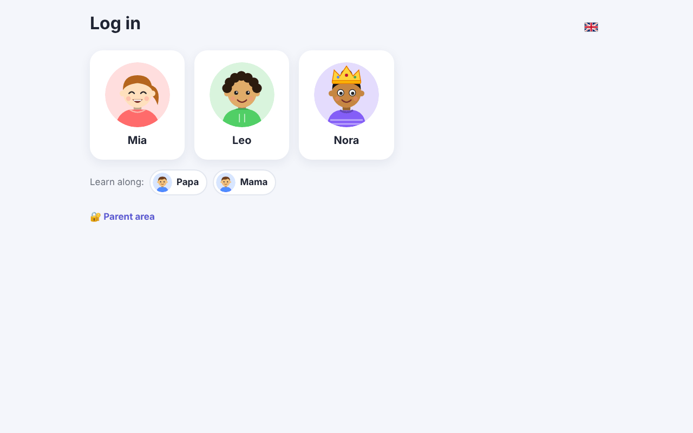
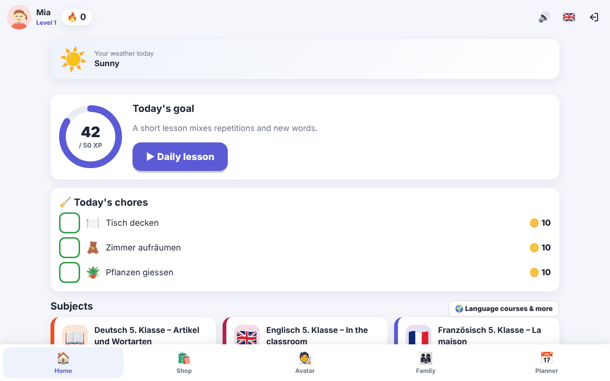
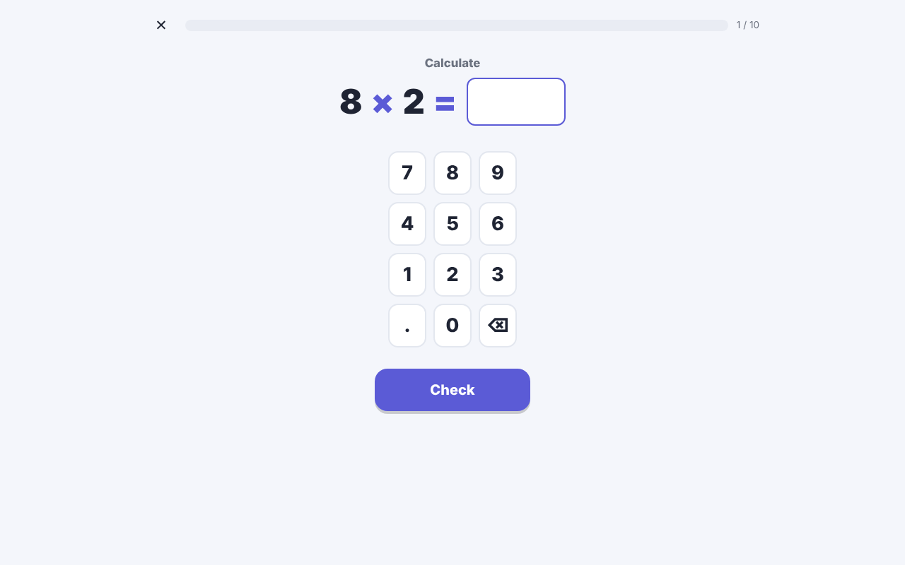
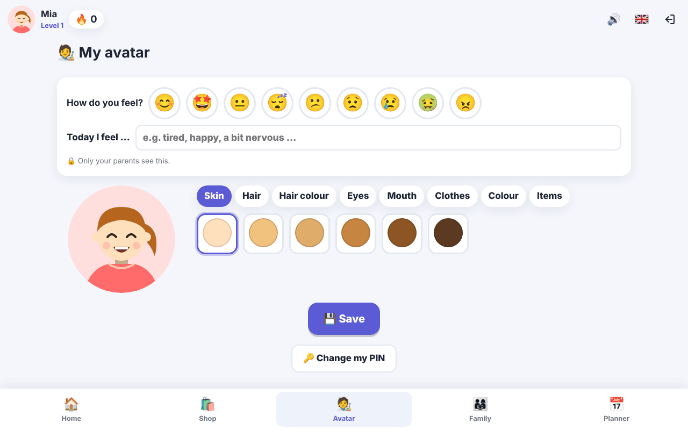
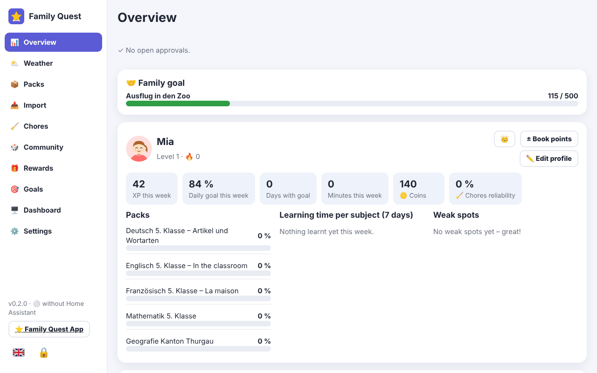
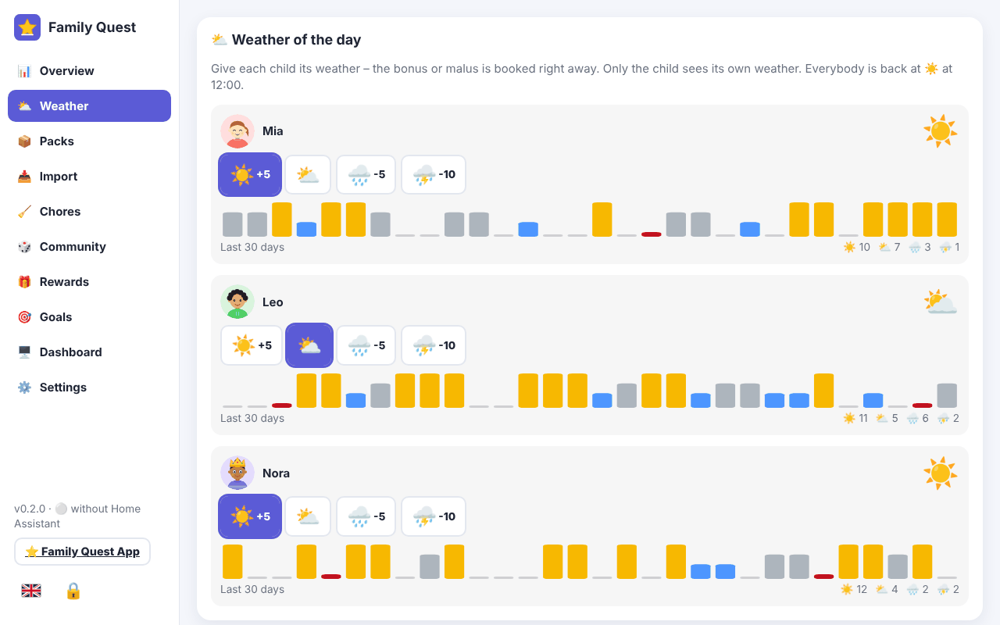
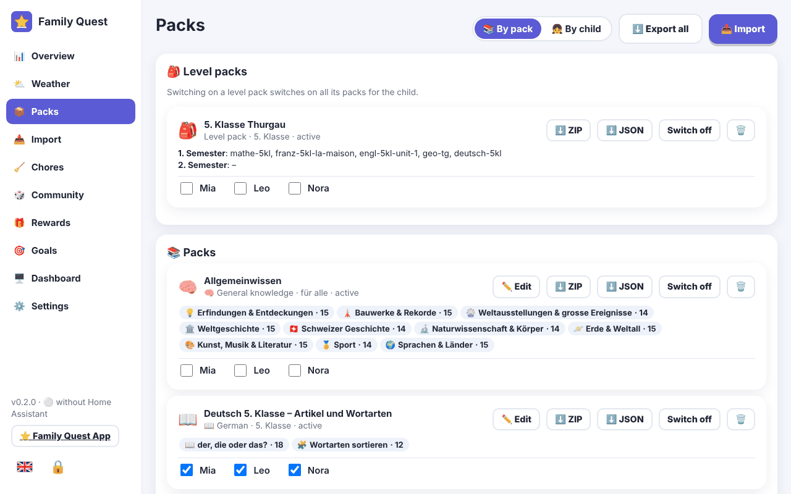

<p align="center">
  
</p>

<h3 align="center">Organize your family life with gamification</h3>

<p align="center">
  <b>The family app for Home Assistant: learning with points and avatars, chores, the Family Planer, games and a
  family dashboard – everything local, no cloud.</b><br>
  learning packs · daily lesson · chore plan · behaviour weather · family quiz &amp; bingo · kiosk dashboard · internet time with UniFi
</p>

<p align="center">
  <a href="https://my.home-assistant.io/redirect/supervisor_add_addon_repository/?repository_url=https%3A%2F%2Fgithub.com%2Fha-unifi-friends%2FFamiliyQuest"></a>
  <br>
  <sub>or add manually: <a href="https://github.com/ha-unifi-friends/FamiliyQuest"><code>https://github.com/ha-unifi-friends/FamiliyQuest</code></a></sub>
</p>

Family Quest is a Home Assistant app for the whole family. Children learn any school subject, do their chores and
earn points for both; parents set the rules, approve rewards and see at a glance how everybody is doing. The
[Family Planer](https://github.com/magi1982/family-planer) runs inside the app, so chores, to-dos and lists live in
one place. No ads, no account, no cloud: all data stays in Home Assistant.

## Screenshots

| | |
|---|---|
|  |  |
| **Log in** – each child with its own avatar and an optional picture or digit PIN | **Start page** – weather of the day, daily goal, chores, subjects |
|  |  |
| **Lessons** – flash cards, quiz, typing, pairs, drag & drop, maths trainer | **Avatar and mood** – items to earn, «How do you feel?» only for the parents |
|  |  |
| **Parent overview** – approvals, family goal, every child with points and progress | **Behaviour weather** – ☀️ bonus or 🌧️ malus with one tap, 30-day graph |
|  |  |
| **Packs** – grouped by pack or by child | **Dashboard** – a family screen for any wall tablet or TV |

<sub>Demo data. The app speaks English, German, Swiss German, French, Italian, Spanish, Dutch, Polish, Portuguese and Swedish.</sub>

## What it does

<sub>Many of these features are new in **Family Quest Beta** (0.3.0) and come to Family Quest with the next release.</sub>

**Learning**
- **Any subject, same rules:** French, maths, German, English, geography of canton Thurgau … as *packs* (YAML/ZIP),
  grouped into *level packs* such as «5. Klasse Thurgau». Language courses (German, French, English, Spanish A1–B1)
  and a general knowledge pack are included.
- **Learning forms:** learning path, daily lesson (~10 minutes of due repetitions plus a few new cards), quiz round,
  flash cards, pairs (also with your own photos), gap text, listening, typing with é è à ç keys, drag & drop and an
  arithmetic trainer with endless generated tasks.
- **Spaced repetition:** five Leitner boxes per card and per arithmetic skill; a unit gets 0–5 stars when its cards
  really sit.

**Points, rewards and behaviour**
- **Accounts and rules:** freely definable accounts (XP, coins, internet minutes …) and rules «event → amount →
  account» with daily limits.
- **Shop:** vouchers, internet minutes, Home Assistant scripts and avatar items (pirate hat, viking helmet, parrot …);
  parents approve in the app or with the buttons of a push message.
- **Behaviour weather:** parents give each child its weather of the day – ☀️ with a bonus, 🌧️ or ⛈️ with a malus.
  Symbols, points and the daily reset are configurable; a child only sees its own weather.
- **Crown for a day** (e.g. on Epiphany), moods with a quiet message to the parents.

**Family life**
- **Chore plan (Ämtliplan)** with fixed or rotating chores, duty or bonus, confirmed by the parents.
- **Family Planer inside:** week plan, special chores, to-dos, shopping lists, awards and seasons – its persons are
  the Family Quest profiles and both share one points balance.
- **Community:** live family quiz (kids create quizzes too, templates for cantons, capitals, flags …), family
  council with proposals and votes, bingo with a ball carousel.
- **Kiosk dashboard:** a read-only family screen for any browser – clock, crown, weather, learning progress, coins,
  open chores, family goal, Planer to-dos and calendar events.

**Home Assistant**
- Sensors per child (XP today, coins, streak, level, open chores, daily goal), events for lessons, chores and badges,
  learning reminders as announcements.
- **Devices per child:** lights (switch and dim), switches, fans, covers, scenes and scripts a child may control.
- **Internet time with UniFi:** the child starts and stops its internet time; the budget comes from the shop.

**Parents and security**
- Several parents with their own PIN; children with a 4-digit or picture PIN (4 of 12 symbols, tap or draw a line)
  that they can change themselves.
- Login log with IP, MAC and UniFi device name; a mini firewall limits the app and the parent area to address ranges.
- Own texts and own languages (e.g. your dialect) with CSV import/export; backup and restore in one file.
- **Import / export:** CSV/Excel, YAML, JSON, ZIP with pictures, a link, or – with an Anthropic API key – a photo or
  PDF of a word list that Claude turns into a draft.

## Installation

1. Add this repository in Home Assistant (button *Add repository* above, or *Settings › Apps › ⋮ › Repositories*).
2. Install **Family Quest** and start it. It appears in the sidebar.
3. Open it, choose *Parent area*, create the parent profile with a PIN, then add the children (or take them over from
   the Family Planer).
4. On a family tablet: open Family Quest from the sidebar, or switch on `direct_access` (and restart the app) and open
   `http://<home-assistant>:8099` (Family Quest Beta: port 8098) – or scan the QR code under *Parent area › Settings* – then children pick their profile instead of logging into Home Assistant. In the
   browser menu choose *Add to home screen* to start it full screen like an app.

**Beta:** this repository also contains the app **Family Quest Beta** – new versions are tested there first.
It installs next to Family Quest with its own data, its entities start with `family_quest_beta_`, and it has an
orange «BETA» band on its icon. Only install it if you want to try new features early.

Details: [family_quest/DOCS.md](family_quest/DOCS.md) · Pack format: [docs/pakete.md](docs/pakete.md)

## Internet time with UniFi

Choose the child's UniFi firewall/traffic rule (the switch of the UniFi Network integration) in its profile – Family
Quest then manages the budget (account *Internet minutes*) and the child starts and stops the internet time in the app.
No automation or blueprint is needed.

## Languages

The app is available in English, Deutsch, Schwiizerdütsch (Mundart), Français, Italiano, Español, Nederlands, Polski,
Português (Brasil) and Svenska – pick it with the flag button (*Auto* follows the browser). It works like the
[IP Manager for UniFi](https://github.com/ha-unifi-friends/ha-ip-manager-unifi): translations are plain JSON files in
[`family_quest/app/web/i18n/`](family_quest/app/web/i18n/), the key is the English text, `{0}`, `{1}` … are
placeholders and may be reordered. Learning content, names and pack titles are never translated.
`python3 tools/i18n_extract.py --check` lists missing keys per language. Corrections and new languages are welcome.

## Development

```bash
python3 -m venv .venv && .venv/bin/pip install -r family_quest/requirements.txt pytest
.venv/bin/pytest
cd family_quest/app && FQ_DATA_DIR=/tmp/fq FQ_HA_DISABLED=1 ../../.venv/bin/uvicorn familyquest.main:app_factory --factory --port 8099
```

Open <http://localhost:8099> (children) and <http://localhost:8099/eltern> (parents). The web app has no build step
(plain JavaScript, no framework); the backend is FastAPI with SQLite in `/data`.

## License

Family Quest is a non-commercial hobby project, made for private use in families: it is not sold, has no ads
and no tracking, and is not affiliated with any of the products or brands mentioned.

MIT – see [LICENSE](LICENSE). Parts by others (Family Planer, Material Design Icons, QR code generator)
are listed with their licenses in [THIRD_PARTY_NOTICES.md](THIRD_PARTY_NOTICES.md).
