<p align="center">
  
</p>

<h3 align="center">Organize your family life with gamification</h3>

<p align="center">
  <b>The family app for Home Assistant that makes everyday family life easier and more playful: every child's tasks, learning,
  FamilyTime and OfflineTime, bonus and malus – and games that bring the whole family to one table.
  Everything local, no cloud.</b><br>
  learning packs · daily lesson · chore plan · 25+ family games · guests via QR code · pets · shop &amp; pranks · calendar · Bring! shopping list · kiosk dashboard · internet time with UniFi
</p>

<p align="center">
  🇬🇧 English · 🇩🇪 Deutsch · 🇨🇭 Schwiizerdütsch · 🇫🇷 Français · 🇮🇹 Italiano · 🇪🇸 Español · 🇳🇱 Nederlands · 🇵🇱 Polski · 🇧🇷 Português · 🇸🇪 Svenska
</p>

<p align="center">
  <a href="https://my.home-assistant.io/redirect/supervisor_add_addon_repository/?repository_url=https%3A%2F%2Fgithub.com%2Fha-unifi-friends%2FFamiliyQuest"></a>
  <br>
  <sub>or add manually: <a href="https://github.com/ha-unifi-friends/FamiliyQuest"><code>https://github.com/ha-unifi-friends/FamiliyQuest</code></a></sub>
</p>

<p align="center">
  <a href="https://ko-fi.com/haunififriends"></a>
</p>

Family Quest makes everyday family life easier and more playful. Every child sees its own tasks for the day – chores, learning,
the daily goal – and earns points for them; good days bring a ☀️ bonus, bad ones a 🌧️ malus. Planned FamilyTime
and OfflineTime, internet minutes and screen-free hours are part of the plan, and in the evening the whole family
meets at the same table for a game. Parents set the rules, approve rewards and see at a glance how everybody is
doing; children learn any school subject in small daily lessons. The
[Family Planer](https://github.com/magi1982/family-planer) runs inside the app, so chores, to-dos and lists live in
one place. No ads, no account, no cloud: all data stays in Home Assistant.

## Screenshots

| | | |
|---|---|---|
|  |  | 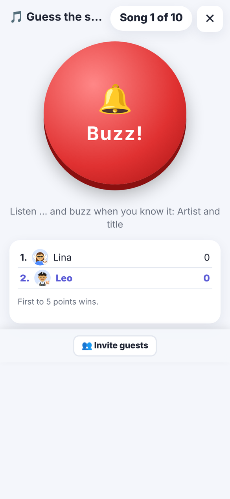 |
| **Picture PIN** – children log in by tapping or drawing 4 of 12 symbols (a digit PIN is possible too) | **Start page** – weather of the day, daily goal, chores, subjects | **Guess the song** – a Home Assistant speaker plays, everybody buzzes on their phone |
| 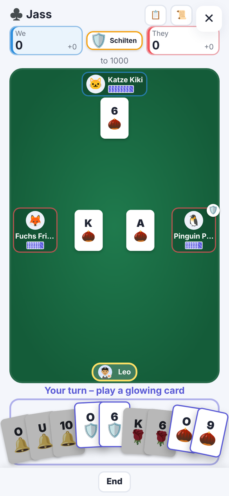 | 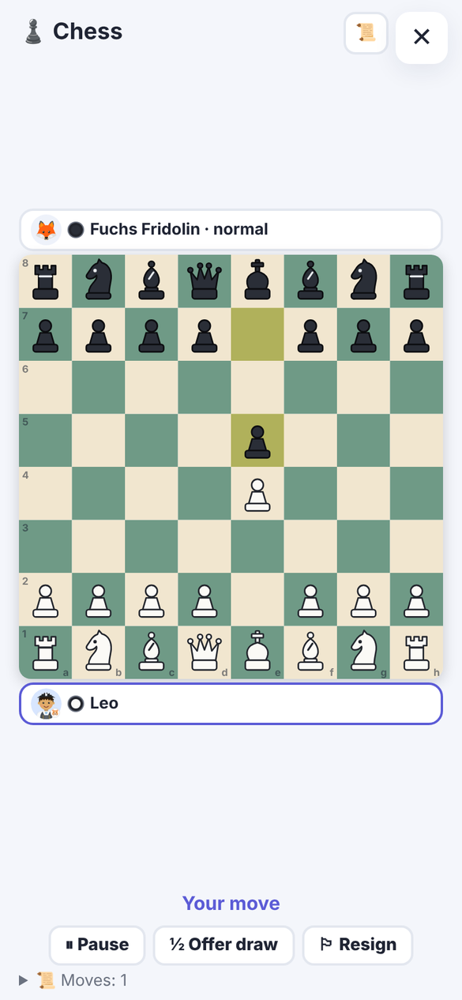 | 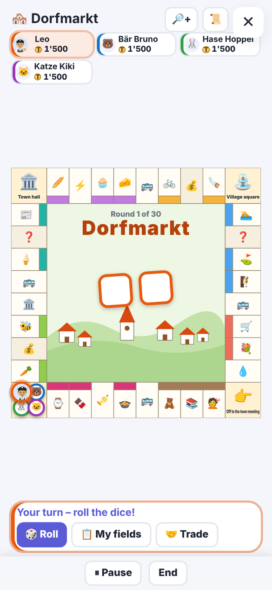 |
| **Jass** – the Swiss card game with bots as partners or opponents | **Chess** – against bots or each other, games can be paused | **Dorfmarkt** – trading board game in a Swiss village |
| 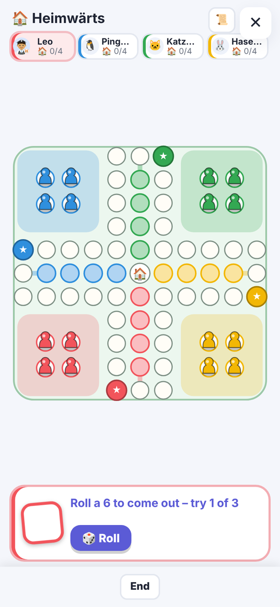 | 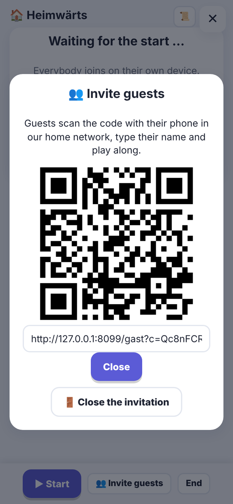 | 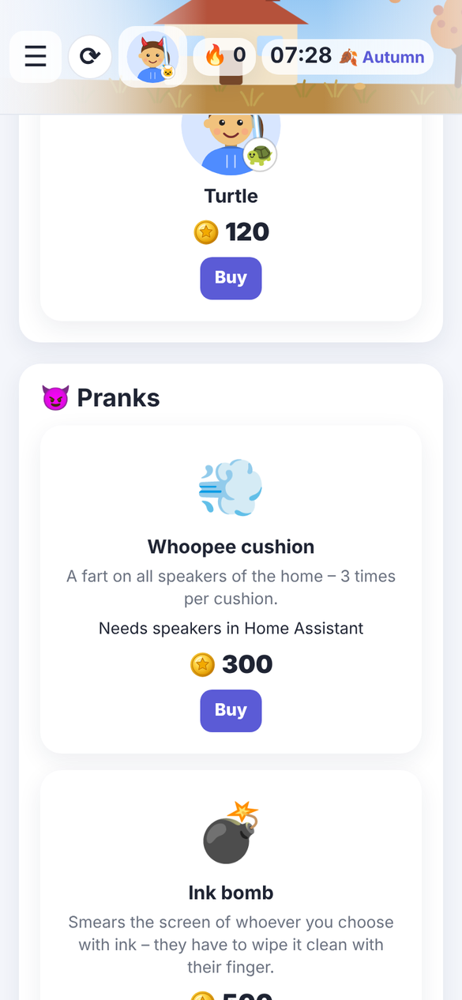 |
| **Heimwärts** – race board game for 2–4 | **Guests welcome** – grandparents, aunts and godparents join with a QR code, also from the guest Wi-Fi | **Shop** – avatar items and pranks like the ink bomb |
| 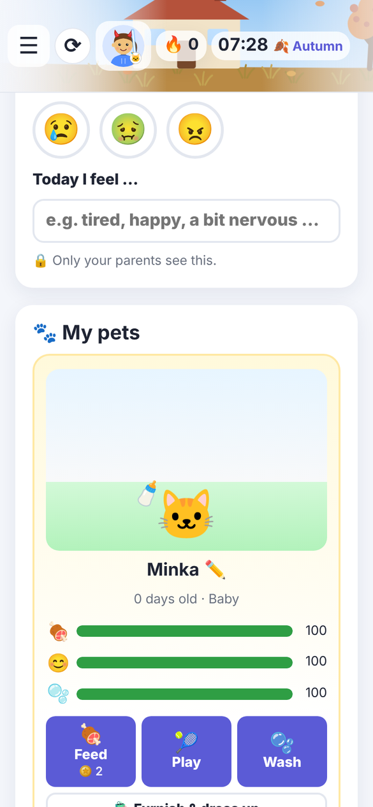 | 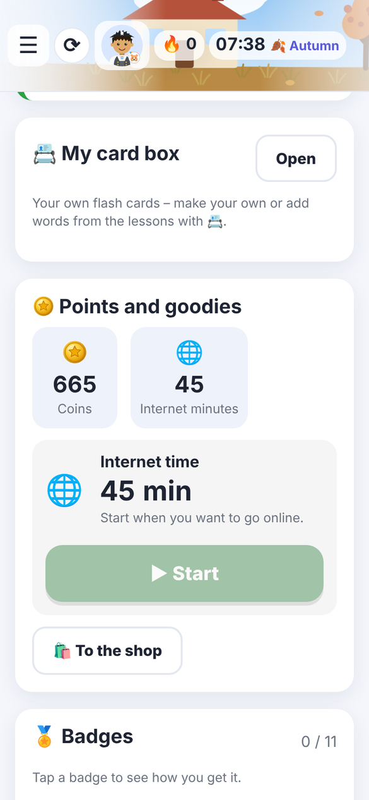 | 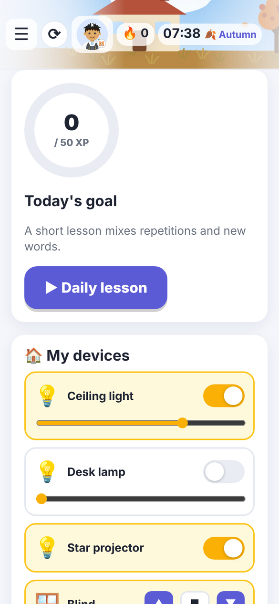 |
| **Pets** – feed, play, wash; pet sitting and babies | **Internet time** – directly integrated with UniFi: the child starts and pauses its own online time | **My devices** – the child switches and dims the lights of its own room |
| 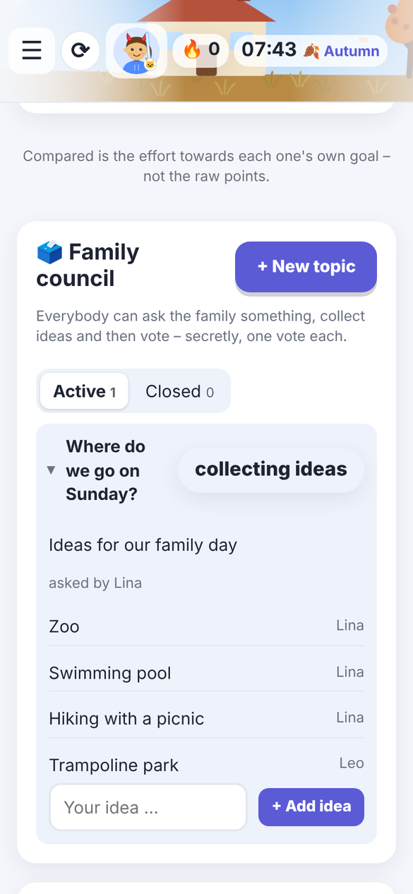 | 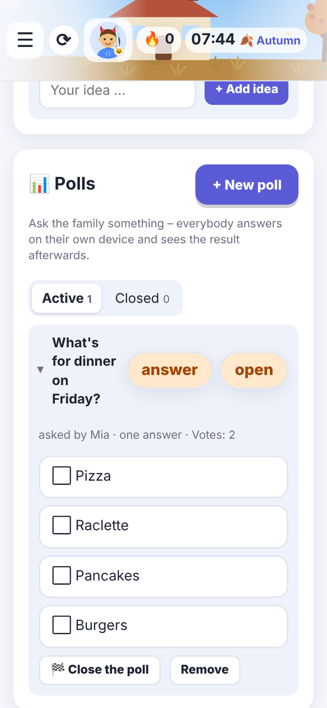 | 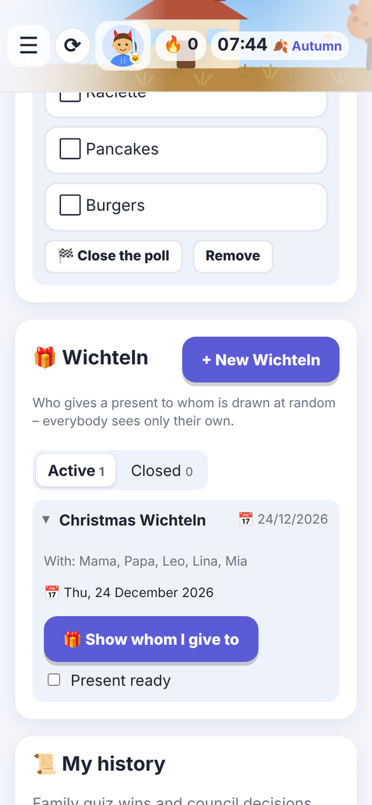 |
| **Family council** – anybody can bring up a topic, everybody adds ideas, then the family votes secretly | **Polls** – ask the family something, everybody answers on their own phone | **Wichteln** – secret gift giving: who gives to whom is drawn, everybody sees only their own |
| 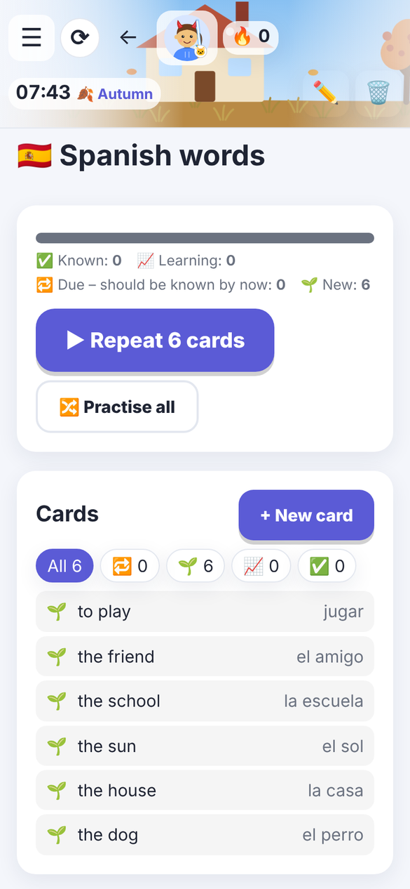 | | |
| **My card box** – personal flash cards; words from any lesson are added with one tap | | |

| | | |
|---|---|---|
|  | 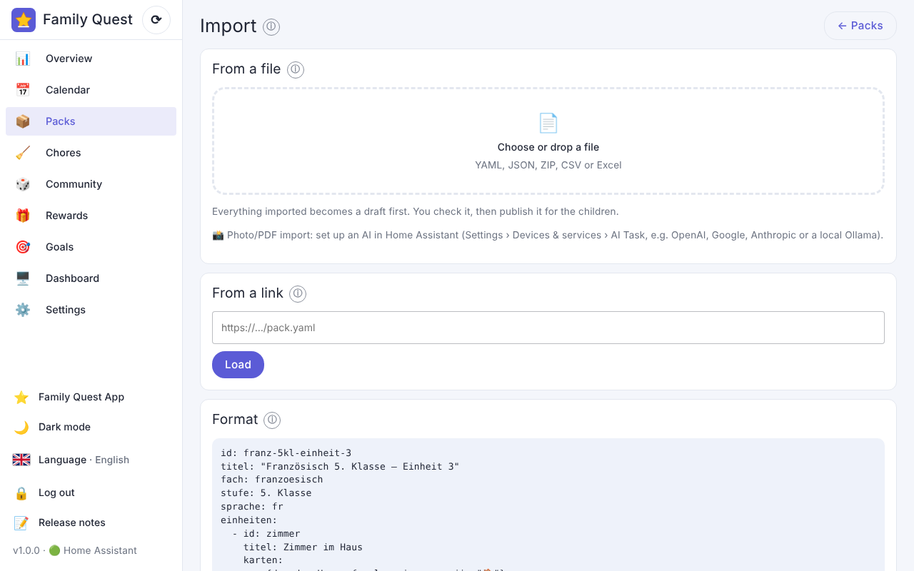 | 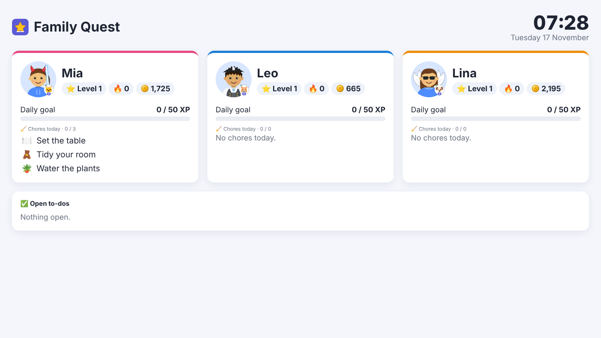 |
| **Parent area** – approvals, behaviour weather, every child at a glance | **Import** – learning material made with your favourite AI and the Family Quest pack format, assigned to the children | **Dashboard** – a family screen for any wall tablet or TV |

<sub>Demo data. Learning content (packs) is not translated and appears in its own language.</sub>

## What it does

**Learning**
- **Any subject, same rules:** French, maths, German, English, geography of canton Thurgau … as *packs* (YAML/ZIP),
  grouped into *level packs* such as «5. Klasse Thurgau». Language courses (German, French, English, Spanish A1–B1)
  and a general knowledge pack are included.
- **Learning forms:** learning path, daily lesson (~10 minutes of due repetitions plus a few new cards), quiz round,
  flash cards, pairs (also with your own photos), gap text, listening, typing with é è à ç keys, drag & drop and an
  arithmetic trainer with endless generated tasks.
- **My card box:** every child has its own flash card decks. From any lesson or unit one tap puts the words into
  the personal card box – repeated with the same Leitner boxes as the lessons.
- **Learning material made with your favourite AI:** give ChatGPT, Claude, Gemini or any other AI the Family Quest
  pack format (the example under *Parent area › Packs › Import*, details in [docs/pakete.md](docs/pakete.md)) and ask
  for exactly what your child needs – «French vocabulary, 5th grade, unit 3», «multiplication word problems for 3rd
  grade». Upload the file, check the draft, publish it and assign it to the children – content that fits their school
  year and their textbook.
- **Spaced repetition:** five Leitner boxes per card and per arithmetic skill; a unit gets 0–5 stars when its cards
  really sit.

**Points, rewards and behaviour**
- **Accounts and rules:** freely definable accounts (XP, coins, internet minutes …) and rules «event → amount →
  account» with daily limits.
- **Shop:** vouchers, internet minutes, Home Assistant scripts, avatar items and pranks; parents approve in the app
  or with the buttons of a push message.
- **Behaviour weather:** parents give each child its weather of the day – ☀️ with a bonus, 🌧️ or ⛈️ with a malus.
  Symbols, points and the daily reset are configurable; a child only sees its own weather.
- **Crown for a day** (e.g. on Epiphany), moods with a quiet message to the parents.

**Games – playing together as a family** (own menu item, each game can be switched on or off per child)

Family Quest is made to bring the family together: parents and children sit at the same table, each with their own
phone, play, laugh, argue a little over the rules and celebrate the winner – instead of everybody on their own screen.
Most games are built for 2–12 people from 6 to 99 years; bots only fill empty seats.

**When grandma and grandpa, the aunt or the godfather come to visit, nobody watches from the sofa – they play along.**
Guests need no account and no app: they scan the QR code of the game with their own phone, type their name and are
at the table. They can even stay in your **guest Wi-Fi**: allow the guest network's IP range in the parent area and
put a firewall rule in your router that lets exactly this range reach Home Assistant – guests from there only see the
guest page of the game, nothing else of Family Quest or your home.

- **Alone against bots** (easy / normal / hard) **or at a family table** on everybody's own phone; guests (friends,
  grandparents) join with a QR code. Places 1–3 earn coins, the winner wears the «No. 1» hat until the next game.
- **Board and card games:** Jass (Schieber), chess (games can be paused), Dorfmarkt (property trading in a Swiss
  village), Heimwärts (race board game), Tschau Sepp, Kartenkarussell, Kartenlauf, Domino, Texas Hold'em, Fünf Würfel.
- **Party games:** Werwölfe (the app is the game master), Verbotene Wörter, Zeichnen & Raten, «Wer bin ich?»,
  Stadt-Land-Fluss, family quiz, bingo, «Errate den Song» with a Home Assistant speaker.
- **Action:** Jump (everybody in their own lane), Klatsch den Beat (rhythm), Paarjagd (pairs with own photo sets),
  Ping-Pong (also 2 against 2), Tic-Tac-Toe, Sudoku, Patience and a one-armed bandit.

**Pets, avatar and shop**
- **Pets** to look after (feed, play, wash) – cat, dog, hamster that mines coins, dino egg, goldfish, turtle …,
  babies, pet sitting by a family member or the pet hotel.
- **Avatar items** to earn: jetpack, wings, laser sword, dark knight helmet, pirate apprentice, devil horns …
- **Pranks:** the ink bomb (the screen of chosen family members gets smeared and must be wiped clean) and the whoopee
  cushion (a fart on all speakers of the home).

**Family life**
- **Chore plan (Ämtliplan)** with fixed or rotating chores, duty or bonus, confirmed by the parents.
- **Family Planer inside:** week plan, special chores, to-dos, shopping lists, awards and seasons – its persons are
  the Family Quest profiles and both share one points balance.
- **Guess the song:** a Home Assistant speaker plays the family playlist, whoever buzzes first answers.
- **Family council:** anybody – children too – brings up a topic («Where do we go on Sunday?»), everybody adds
  ideas, then the family votes secretly, one vote each; decisions land in the history.
- **Polls:** ask the family something quickly («What's for dinner on Friday?»), single or multiple choice, also
  anonymous, everybody answers on their own phone.
- **Wichteln:** secret gift giving – who gives a present to whom is drawn (optionally no parent–parent or kid–kid
  pairs), everybody sees only their own, with a date and «present ready».
- **Family quiz:** live on everybody's phone; kids create quizzes too, templates for cantons, capitals, flags …
- **Kiosk dashboard:** a read-only family screen for any browser – clock, crown, weather, learning progress, coins,
  open chores, family goal, Planer to-dos and calendar events.

**Home Assistant**
- Sensors per child (XP today, coins, streak, level, open chores, daily goal), events for lessons, chores and badges,
  learning reminders as announcements.
- **Devices per child:** lights (switch and dim), switches, fans, covers, scenes and scripts a child may control.
- **Internet time, directly integrated with UniFi:** pick the child's UniFi firewall / traffic rule – the child
  starts and pauses its online time in the app, the minutes come from its budget (per day / week, block times) and
  the shop. No automation or blueprint needed.
- **Family calendar** with your Home Assistant calendars, school holidays, FamilyTime and OfflineTime.
- **Shopping list synced with Bring!** (through the Home Assistant to-do integration) – right in the planner.

**Parents and security**
- Several parents with their own PIN; children with a 4-digit or picture PIN (4 of 12 symbols, tap or draw a line)
  that they can change themselves.
- Login log with IP, MAC and UniFi device name; a mini firewall limits the app and the parent area to address ranges.
- Own texts and own languages (e.g. your dialect) with CSV import/export; backup and restore in one small file
  (photos from Home Assistant Media are only referenced).
- **Import / export:** CSV/Excel, YAML, JSON, ZIP with pictures, a link, or a photo or PDF of a word list that the AI
  set up in Home Assistant (AI Task: OpenAI, Google, Anthropic, a local Ollama …) turns into a draft.
- Parents see every running game and can end one or all of them.

## Installation

1. Add this repository in Home Assistant (button *Add repository* above, or *Settings › Apps › ⋮ › Repositories*).
2. Install **Family Quest** and start it. It appears in the sidebar.
3. Open it, choose *Parent area*, create the parent profile with a PIN, then add the children (or take them over from
   the Family Planer).
4. On a family tablet: open Family Quest from the sidebar, or switch on `direct_access` (and restart the app) and open
   `http://<home-assistant>:8099` (Family Quest Beta: port 8098) – or scan the QR code under *Parent area › Settings* – then children pick their profile instead of logging into Home Assistant. In the
   browser menu choose *Add to home screen* to start it full screen like an app.

**Beta:** this repository also contains the app **Family Quest Beta** – new versions are tested there first.
It installs next to Family Quest with its own data, its entities start with `family_quest_beta_`, and it has an
orange «BETA» band on its icon. Only install it if you want to try new features early.

Details: [family_quest/DOCS.md](family_quest/DOCS.md) · Pack format: [docs/pakete.md](docs/pakete.md)

## Internet time with UniFi

Choose the child's UniFi firewall/traffic rule (the switch of the UniFi Network integration) in its profile – Family
Quest then manages the budget (account *Internet minutes*) and the child starts and stops the internet time in the app.
No automation or blueprint is needed.

## Languages

The app is available in English, Deutsch, Schwiizerdütsch (Mundart), Français, Italiano, Español, Nederlands, Polski,
Português (Brasil) and Svenska – pick it with the flag button (*Auto* follows the browser). It works like the
[IP Manager for UniFi](https://github.com/ha-unifi-friends/ha-ip-manager-unifi): translations are plain JSON files in
[`family_quest/app/web/i18n/`](family_quest/app/web/i18n/), the key is the English text, `{0}`, `{1}` … are
placeholders and may be reordered. Learning content, names and pack titles are never translated.
`python3 tools/i18n_extract.py --check` lists missing keys per language. Corrections and new languages are welcome.

## Development

```bash
python3 -m venv .venv && .venv/bin/pip install -r family_quest/requirements.txt pytest
.venv/bin/pytest
cd family_quest/app && FQ_DATA_DIR=/tmp/fq FQ_HA_DISABLED=1 ../../.venv/bin/uvicorn familyquest.main:app_factory --factory --port 8099
```

Open <http://localhost:8099> (children) and <http://localhost:8099/eltern> (parents). The web app has no build step
(plain JavaScript, no framework); the backend is FastAPI with SQLite in `/data`.

## License

Family Quest is a non-commercial hobby project, made for private use in families: it is not sold, has no ads
and no tracking, and is not affiliated with any of the products or brands mentioned. If it helps your family,
you can buy us a coffee on [Ko-fi](https://ko-fi.com/haunififriends) ☕ – thank you!

MIT – see [LICENSE](LICENSE). Parts by others (Family Planer, Material Design Icons, QR code generator)
are listed with their licenses in [THIRD_PARTY_NOTICES.md](THIRD_PARTY_NOTICES.md).
